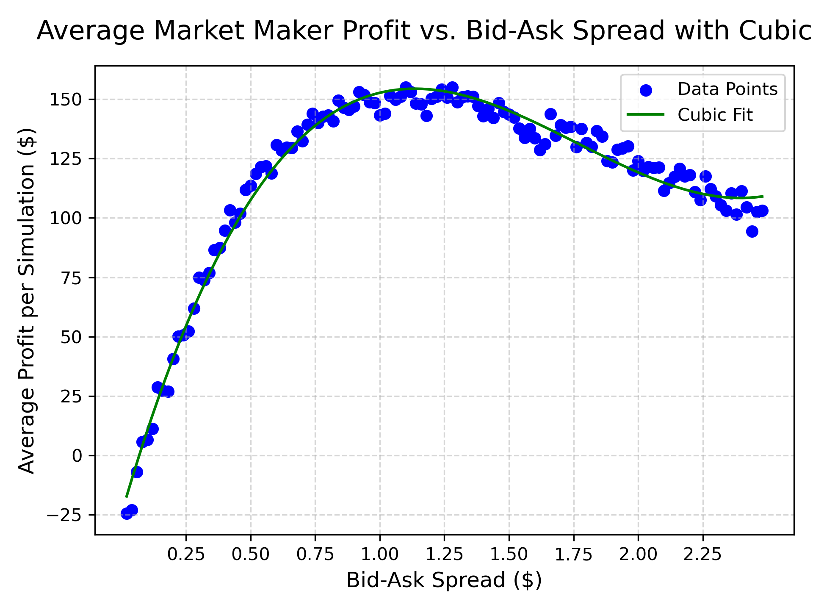
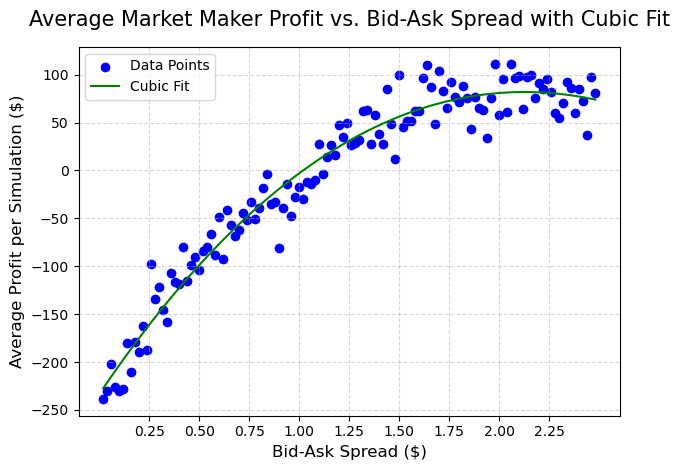
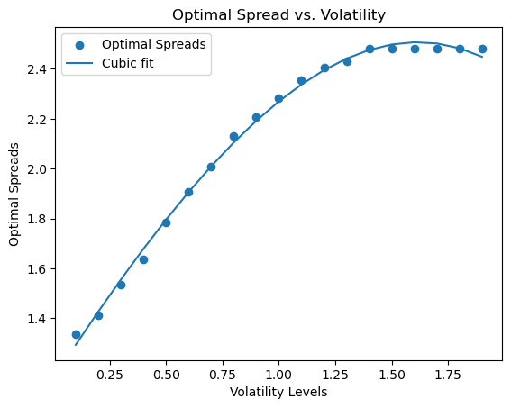
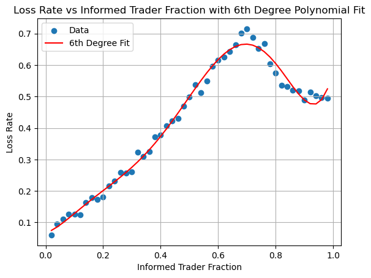
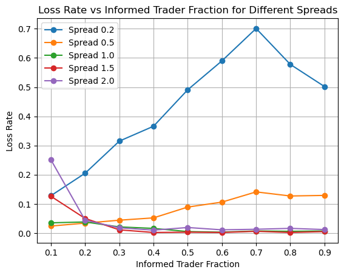
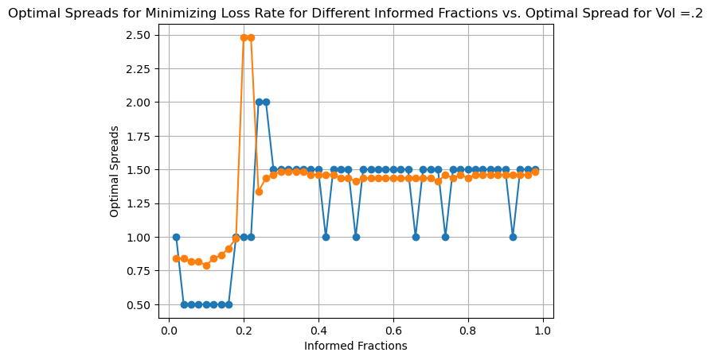

# Market-Model
Researching a market simulation to get a better understanding of optimal ask-bid spread, and the effects of volatility, information, and other variables.

## Research Questions
- How does market volatility affect profit?
- What ask-bid spread is optimal for maximizing profitability?
- Does volatility change a spread's profitability?
- What are the impacts of a more informed customer-base?

## Model/Logic
My simulation mimicks the scenario of a market maker posting bid and ask prices around a fair price. It takes into account different buy/sell rational based on if customers are potentially informed on the direction of price change or not.
- Fair Price: Changes over time based on random price changes.
- Bid/Ask Prices: Determined by the given spread around the fair price.
- Customer Arrivals: Arrival probability decreases as given spread increases.
- Customer Behavior: Uninformed customers make decisions based on their estimated valuations, whilst informed customers choose based on their prediction of the price change.
- Transaction Costs: Each trade incurs a transaction cost.
- Inventory Limit: Market maker can not exceed a certain inventory.

## Experimental Design
The simulation varies the bid-ask spread, volatility, number of "trade steps" that are simulated, as well as the proportion of informed traders. For each of these, multiple simulations are ran, where key metrics are noted. These metrics were average profitability, standard deviation of profit, number of total trades, as well as what percent of simulations ended in a loss.

## Results

### Bid-Spread Vs. Profitability

By setting all other variables constant, I was able to clearly see how the bid-ask spread affects profitability as it increases.

What I expected to find:
- Very low spreads would lead to low profitability as well, mostly due to how having such small margins fails to amke up for the risk of constant price fluctuations in the market.
- Even though each experiment contains seemingly random price changes at each step, the sheer amount of trials would allow the average profitability to show a clear pattern as spread increases.

What surprised me:
- While the low spread values unsurprisingly returned low profitability, once the spread got too wide, it began to turn away enough customers to bring down profitabilty, despite high margins.
- The cubic fit makes this model more complicated than "profitability goes up and then it goes down" which may go along with the low loss rate of higher spreads,

Seeing the strength of this relationship made me wonder how it would change given higher levels of volatility in the market.

Not only did increase volatility from .2 to .8 not only spread out the points, but also shifted the max spread to the right. This makes sense, as higher volatility in the market means you need higher margins to "blanket" you from too many losses.

This did prompt me to instead look at the relationship between increased volatility and its effect on the optimal spread for maximum average profit. What I found out was it was a mostly linear relationship, but as it approaches a spread of around 2.5, the graph levels out. It seems like this is the point where any higher of a spread means little to no customers are actually buying anything.

So even though the relationship is close to linear, a cubic graph actually represents it better, and is what I used to approximate it. Now that I have this relationship, I was able to create a function that, given any volatility, can return the optimal spread.

Next I am going to see if I can see how the percentage of informed traders can affect the loss rate of the simulation.

### Informed Percentage vs. Loss Rate

When I was looking through my original trading research data, specifically involving how different informed percentages affected certain variables, the effect on loss rate stood out to me the most. While the other relationships seemed rather linear, this one was different based on the informed percentage itself. For the graph above, I plotted a range of information percentages to see the output (with spread set to .2). To my surprise the line was best approximated by this 6th degree polynomial line of best fit, which only heightened my curiosity about how these variables relate to each other.

But like I said before, the original interesting relationship was a graph showing how different information percentages affected loss rate plotted across a list of different bid-ask spreads. So now I wanted to see how increasing the spread from .2 would affect things. 

What I expected:
- As spread increased, loss rates began to diminish overall, because higher profit margins give the market makers more room for the price changes
- With less losses, the overall relationships of the graphs with higher spreads would be a lot flatter

What surprised me:
- Only a spread of .5 had a similar relationship to .2, with the rest approaching zero as information increased.
- After a spread of .5, each spread after that had a higher loss rate for a small percentage of informed traders than the last, competely reversing the trend from .2 to .5.

So even though I was not expecting the graph to look like this, by taking time to process and think through, it started to make more sense. The way the logic works is that uninformed traders buy and sell based on where the ask/bid is relative to their own evaluation of the product, while informed traders act off of the direction in which they believe the price is moving. Therefore when spread values are too high, you will get very little business form uninformed traders, yet informed traders will still be willing to invest if they truly think they know where the market is heading. So when firms put their spreads too high in a market with too many uninformed traders, there won't be enough transactions in a lot of cases to earn them a profit. 

Seeing this model, however, did interest me in another thing. What if I could, for any given informed percentage, get what the optimal spread is in that instance for minimizing loss rate. To test this, first I graphed how this minimizing function would work using the same spread values from before. After that, I decided to see what my optimal spread function for any given volatility from before would return if I held the volatility constant and switched the infromed percentages. From thsi I was able to plot the two on top of each other and see how similar the results are. 

Blue is the optimal spread for minimizing loss rate (from the list of spread values), while orange is simply the volatility optimal spread function's output given that informed rate.

While for the most part these graphs are verys imilar, they do have a few striking moments of disagreement. However, this can be left up to the fact that the optimal spread given any volatility function has more freedom with which volatility it could return, whilst the blue grpah beneath it is more constrained. What is important is how the direction they move is very similar. To further test their similarity, I checked both their mean absolute difference and root mean squared difference, the first returning a value of roughly .213, while the latter returning .380. So while these two functions are similar, they are not perfectly aligned.

However, both average profitability and loss rate are important to a market maker. While firms want higher profits, if it runs the risk of a potential loss in a volatile market, it may not always be the best choice. What if I could combine these two ideas and create a function that would approximate the optimal spread given any volatility and informed percentage? That is what I wish to accomplish in the next section.

### Ideal Market Strategy

With the information I have looked into and the reuslts I've gathered, I realized that while most variables going into the market simulation behave as one would expect, the three that gave the most non-obvious relationships were the bid-ask spread, volatility, and informed percentage. These variables returned very intriguing and non-linear relationships that really explore the logic of this simulation and the broader market in general. Using the models I have gathered and the functions I have made, I wanted to answer one final question: What bid-ask spread is the best choice to try and maximize profits whilst minimizing loss rate. To answer this, I created a regression model to fit the behaviors of both volatility and informed percentage to create a function that takes in both values. 

By testing how these variables interacted with each other using two lists, I was able to get a rough model I fitted with a regression curve. The curve not only could estimate the optimal spread based on both the volatility and informed percentage, but also, when plugged into the original market simulation, return the average profit with that spread. 