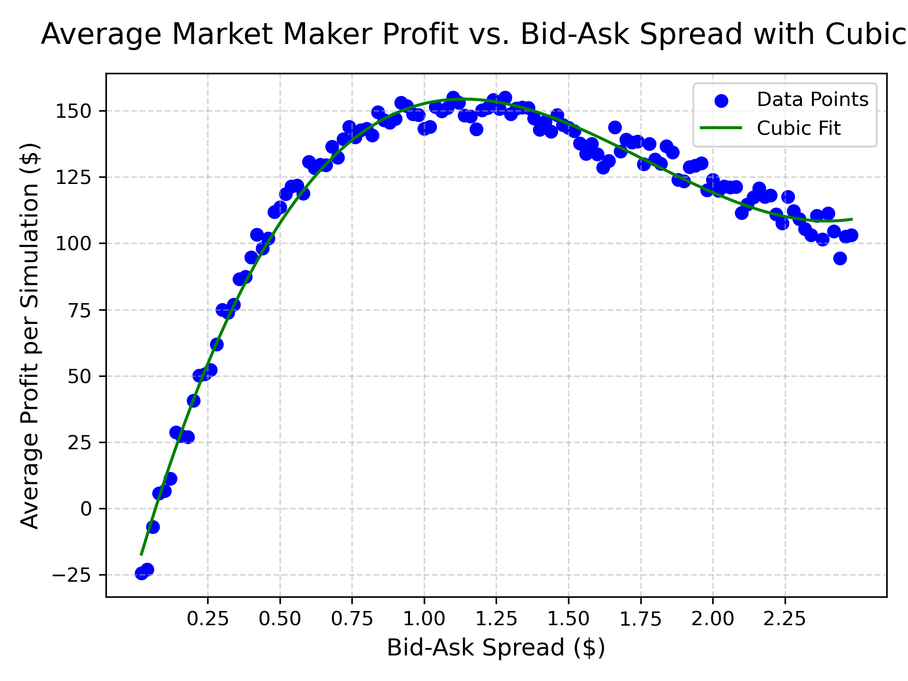
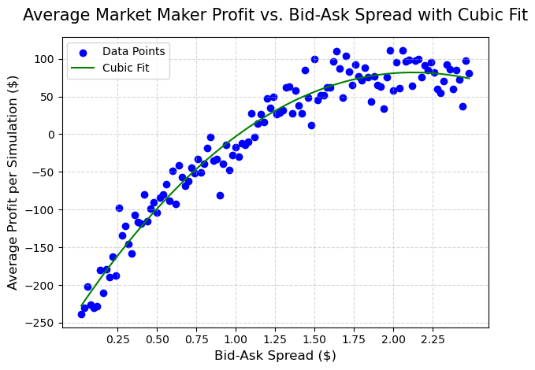

# Market-Model
Researching a market simulation to get a better understanding of optimal ask-bid spread, and the effects of volatility, information, and other variables.

## Research Questions
- How does market volatility affect profit?
- What ask-bid spread is optimal for maximizing profitability?
- Does volatility change a spread's profitability?
- What are the impacts of a more informed customer-base?

## Model/Logic
My simulation mimicks the scenario of a market maker posting bid and ask prices around a fair price. It takes into account different buy/sell rational based on if customers are potentially informed on the direction of price change or not.
- Fair Price: Changes over time based on random price changes.
- Bid/Ask Prices: Determined by the given spread around the fair price.
- Customer Arrivals: Arrival probability decreases as given spread increases.
- Customer Behavior: Uninformed customers make decisions based on their estimated valuations, whilst informed customers choose based on their prediction of the price change.
- Transaction Costs: Each trade incurs a transaction cost.
- Inventory Limit: Market maker can not exceed a certain inventory.

## Experimental Design
The simulation varies the bid-ask spread, volatility, number of "trade steps" that are simulated, as well as the proportion of informed traders. For each of these, multiple simulations are ran, where key metrics are noted. These metrics were average profitability, standard deviation of profit, number of total trades, as well as what percent of simulations ended in a loss.

## Results

### Bid-Spread Vs. Profitability
`
By setting all other variables constant, I was able to clearly see how the bid-ask spread affects profitability as it increases.

What I expected to find:
- Very low spreads would lead to low profitability as well, mostly due to how having such small margins fails to amke up for the risk of constant price fluctuations in the market.
- Even though each experiment contains seemingly random price changes at each step, the sheer amount of trials would allow the average profitability to show a clear pattern as spread increases.

What surprised me:
- While the low spread values unsurprisingly returned low profitability, once the spread got too wide, it began to turn away enough customers to bring down profitabilty, despite high margins.
- The cubic fit makes this model more complicated than "profitability goes up and then it goes down" which may go along with the low loss rate of higher spreads,

Seeing the strength of this relationship made me wonder how it would change given higher levels of volatility in the market.

Not only did increase volatility from .2 to .8 not only spread out the points, but also shifted the max spread to the right. This makes sense, as higher volatility in the market means you need higher margins to "blanket" you from too many losses.

This did prompt me to instead look at the relationship between increased volatility and its effect on the optimal spread for maximum average profit. What I found out was it was a mostly linear relationship, but as it approaches a spread of around 2.5, the graph levels out. It seems like this is the point where any higher of a spread means little to no customers are actually buying anything.

So even though the relationship is close to linear, a cubic graph actually represents it better, and is what I used to approximate it. Now that I have this relationship, I was able to create a function that, given any volatility, can return the optimal spread.

Next I am going to see if I can see how the percentage of informed traders can affect the loss rate of the simulation.